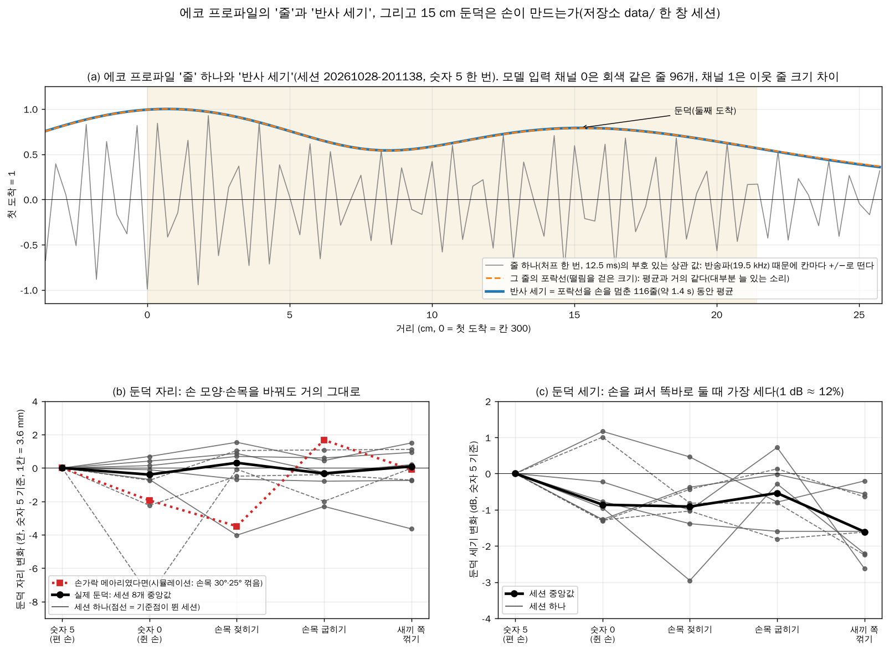
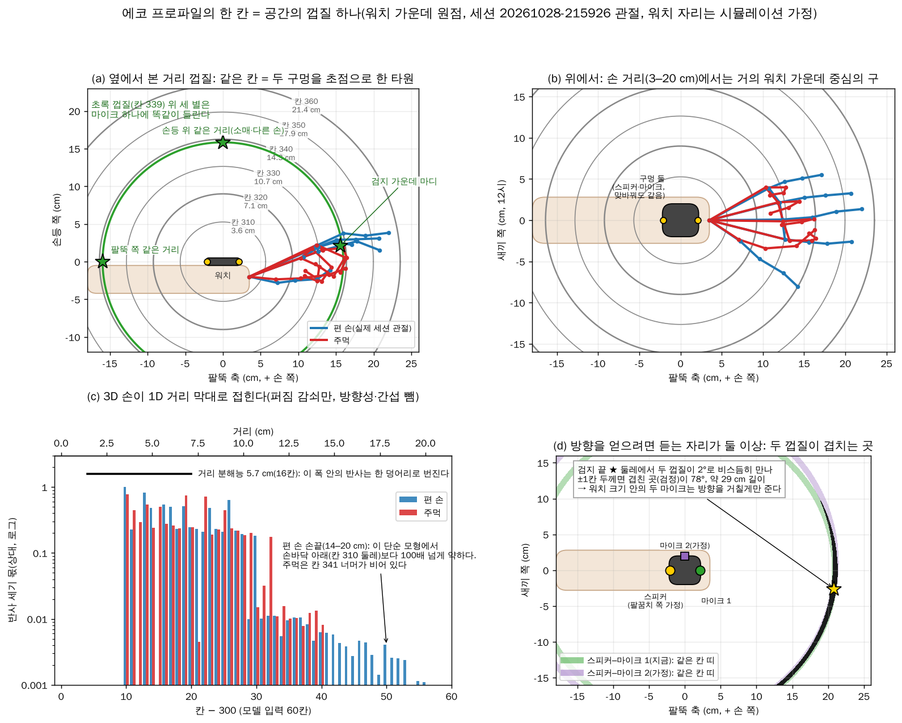
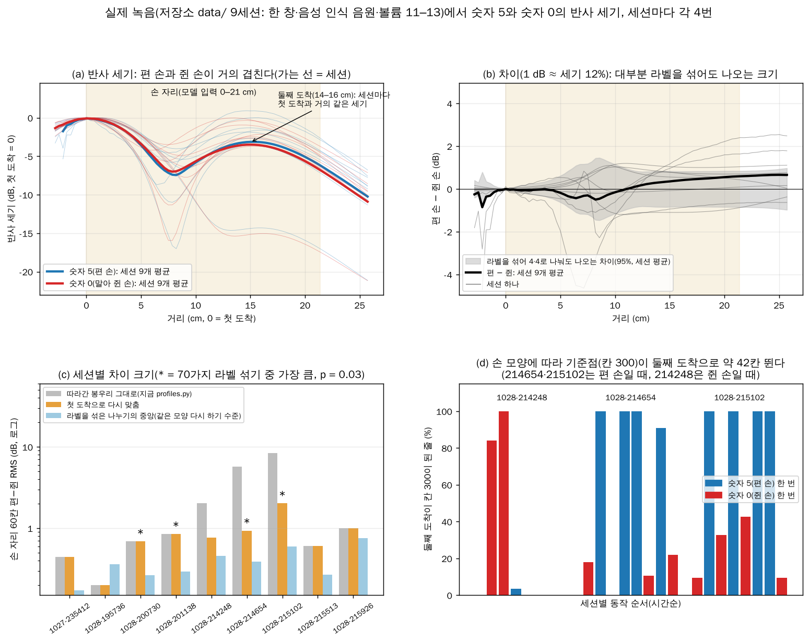

# 에코 프로파일: 공간의 뜻, 좌표계, 실제 손 모양, 둘째 도착

2026-11-03 기준입니다. 아래 물음들을 계산·실제 녹음·시뮬레이션으로 봤습니다.
- 에코 프로파일의 "줄"과 "반사 세기"는 무엇인가, 칸 하나는 공간에서 무엇인가, 좌표계를 바꿀 수 있나
- 워치 소리는 단일인가, 마이크가 둘이면 무엇을 더 얻나, 스피커 쪽 구멍은 왜 둘인가, 도면은 있나
- 실제 녹음에서 편 손과 쥔 손의 반사 세기가 다른가
- 그 과정에서 찾은 직접 경로 뒤 약 15 cm의 "둘째 도착"은 무엇이고 손이 만드는가

요약은 [연구 현황 5.14](research-status.md)에 있습니다. 실제 녹음은 모두 저장소 `data/`의 10-27–28 세션(처프 창 hann, 녹음 음원 VOICE_RECOGNITION)입니다. 그 뒤의 Tukey·창 없음 세션은 저장소에 없어 보지 못했습니다. 표기는 연구 현황과 같습니다: **[확인]** 계산·실측으로 잰 것, **[추정]** 정황으로 본 것, **[미확인]** 아직 확인하지 못한 것.

## 0. 한눈에

1. **에코 프로파일의 칸 하나는 공간의 껍질 하나다.** [확인: 기하]
   - 스피커 → 반사점 → 마이크 경로 길이가 같은 점들, 곧 두 소리 구멍을 초점으로 한 회전 타원체 껍질이다.
   - 손이 있는 3–20 cm에서는 워치 가운데가 중심인 구에 가깝고, 반지름은 "거리 + 2.1 cm"다(구멍 간격 4.2 cm 가정).
2. **마이크 하나로는 입력을 (x, y, z)로 펼 수 없다.** 한 칸 값은 껍질 전체의 합이라 방향 정보가 측정에 없다. [확인]
   - 방향을 얻으려면 듣는 자리가 둘 이상이어야 한다. 워치 안의 두 마이크는 방향을 거칠게만 준다.
   - 시뮬레이션에서 두 번째 마이크를 손목 옆면에 두면 kNN 되읽기가 18.3 → 17.8 mm였다. 같은 자리나 바로 옆에 두면 이득이 없었다. [확인: 시뮬레이션]
3. **출력(정답) 좌표계는 바꿀 수 있다.** 지금 손가락 정답은 손바닥 틀이고 소리는 워치(팔뚝) 기준이다. 워치 축 정답이나 "관절별 워치까지 거리" 보조 목표가 후보다. [추정]
4. **실제 녹음에서 편 손과 쥔 손의 반사 세기는 거의 같다.** [확인]
   - 첫 도착을 칸 300에 맞추면 편 − 쥔은 0–7 cm에서 −0.1 dB, 7–14 cm에서 0.0 dB, 14–21 cm에서 +0.46 dB다(1 dB ≈ 세기 12%).
   - 같은 손 모양을 다시 했을 때의 차이와 비슷하다. 9세션 중 4세션만 라벨을 섞은 것보다 컸고, 처음 보는 세션에서 맞히기는 62%(우연 50%)다.
5. **직접 경로 뒤 38–46칸(14–16 cm)에 첫 도착과 거의 같은 세기의 둘째 도착("둔덕")이 있다.** 10세션 중 9세션에 있다. [확인] 정체는 **[미확인]**.
   - `data/sessions.csv`의 직접 경로 폭 77–85칸은 한 창 때문만이 아니라 이 둘째 도착이 직접 경로와 반높이 위로 붙은 값이다.
6. **`profiles.py`는 가장 센 봉우리를 칸 300에 둔다.** 그래서 둘째 도착이 첫 도착을 넘는 줄에서는 기준점이 약 42칸 뛴다. [확인]
   - 214654는 줄의 50%, 215102는 82%가 둘째 도착을 칸 300에 두었다. 모델 입력 창이 약 15 cm 밀린 셈이다.
   - 손 모양에 따라 뛰어서, 지금 정렬로는 편 손과 쥔 손이 2–8 dB 달라 보인다. 첫 도착으로 맞추면 0.8–2.0 dB가 된다.
7. **둔덕은 손이 만든 메아리가 아니다.** 손은 그 위에 1 dB쯤 얹을 뿐이다. [확인: 자리·세기] [추정: 얹힘]
   - 자세를 바꿔도 자리가 그대로이고, 손 메아리로 보기엔 12 dB 넘게 세며, 같은 동작을 한 첫 세션에는 없다.

## 1. 줄 하나와 반사 세기

- **줄:** 처프 한 번(12.5 ms)이다. 워치 녹음을 18–21 kHz로 거르고 보낸 처프와 원형 상관해 값 600개(칸)를 낸다(`tools/profiles.py`).
  - 직접 경로(스피커 → 마이크)를 칸 300에 두고, 시간 방향으로 3줄 중앙값을 건다.
  - 칸 k의 값은 경로가 직접 경로보다 2 × (k − 300) × 3.57 mm 긴 소리가 얼마나, 어떤 위상으로 왔는가다. 상관 "계수"(−1…1로 정규화한 값)가 아니라 정합 필터 출력이다.
- **부호와 떨림:** 값은 반송파(약 19.5 kHz) 때문에 칸마다 +와 −를 오간다(48 kHz에서 한 주기가 2.46표본). 반사체가 약 4 mm 움직이면 그 칸의 부호가 뒤집힌다.
- **반사 세기(이 문서):**
  1. 줄마다 포락선(칸 방향 힐베르트 변환의 크기, 떨림을 걷은 크기)을 낸다.
  2. 첫 도착(직접 경로) 세기로 나눠 제곱한다.
  3. 손을 멈춘 구간(약 1.4 s, 116줄) 동안 평균해 dB로 쓴다.
- **모델 입력은 이 평균이 아니다**(`tools/dataset.py`): 채널 0은 부호 있는 줄 96개(1.2 s, 칸 300–359), 채널 1은 이웃 줄의 |값| 차이다. 둘 다 창마다 표준화한다.
- 한 창 세션에서는 줄 하나의 포락선과 1.4 s 평균이 거의 같다(그림 (a)). 프로파일 대부분은 늘 있는 소리(직접 경로·둘째 도착)이고, 손이 만드는 몫은 그 위의 작은 변화다. [확인]



## 2. 칸 하나 = 공간의 껍질

- 같은 칸 = 스피커 → 반사점 P → 마이크 경로 길이가 같은 점들이다. 칸 300 + k의 거리는 (|PS| + |PM| − 구멍 간격) ÷ 2 = k × 3.57 mm다.
  - 이 점들은 두 소리 구멍을 초점으로 한 회전 타원체를 이룬다. 스피커와 마이크를 맞바꿔도 껍질은 같다.
- 워치 가운데를 원점으로 본 껍질 크기(구멍 간격 4.2 cm 가정, `tools/experiments/echo_geometry.py`): [확인: 기하]

| 칸 | 거리 | 팔뚝 축 방향 반지름 | 옆 방향 반지름 |
|---|---|---|---|
| 310 | 3.6 cm | 5.7 cm | 5.3 cm |
| 320 | 7.1 cm | 9.2 cm | 9.0 cm |
| 330 | 10.7 cm | 12.8 cm | 12.6 cm |
| 340 | 14.3 cm | 16.4 cm | 16.3 cm |
| 360 | 21.4 cm | 23.5 cm | 23.4 cm |

- **같은 껍질 위의 반사는 구별되지 않는다.** 그림 (a)의 초록 껍질 위 세 별(검지 가운데 마디, 손등 위, 팔뚝 쪽)은 마이크에 똑같이 들린다.
- **껍질은 손 쪽만 있는 게 아니다.** 팔뚝·손등 위·몸 쪽까지 닫힌 면이라, 팔뚝 위 소매도 같은 칸에 들어온다. 움직이지 않으면 차분 채널에서 빠진다.
- **모든 방향을 똑같이 듣지도 않는다.** 같은 껍질 위라도 워치 몸체·손목의 가림, 구멍 방향성, 거리 감쇠(1 ÷ (스피커 거리 × 마이크 거리)) 때문에 세기가 다르다.
- **실제 관절의 거리**(세션 20261028-215926, 시뮬레이션 워치 자리):
  - 편 손은 관절이 6.1–20.3 cm에 있고, 손끝은 14.3–20.3 cm다.
  - 주먹은 관절이 5.7–14.5 cm에 있다.
- **3D 손이 1D 막대로 접힌다**(그림 (c), 퍼짐 감쇠만 넣은 단순 모형). 두 자세 모두 가장 센 칸은 310(손바닥 아래)이다. 편 손 손끝 자리(칸 340–356)는 평균이 가장 센 칸의 0.3%, 주먹은 0.06%다.



## 3. 좌표계

### 3.1 입력: 마이크 하나로는 바꿀 수 없다
- 한 칸이 껍질 전체의 합이라, 칸 값에서 (x, y, z)를 되돌리는 변환은 없다. 방향을 되돌릴 정보가 측정 안에 없다. [확인]
- 칸을 "워치 가운데로부터 cm"처럼 다른 이름으로 부를 수는 있지만 정보는 같다.
- 모델은 방향을 손 모양 제약(뼈 길이·관절 범위), 시간에 따른 변화, 방향마다 다른 세기로 짐작한다. WatchHand도 마이크 하나로 같은 방식을 쓴다.

### 3.2 방향 축: 듣는 자리가 둘 이상
- 듣는 자리마다 껍질이 생기고, 둘이 겹치는 곳이 방향이다. 3D의 한 점을 정하려면 셋이 필요하다.
- **워치 크기 안의 두 마이크는 방향을 거칠게만 준다**(그림 (d)). [확인: 기하] [추정: 위상까지 쓴 분해능]
  - 20.9 cm 떨어진 검지 끝에서 두 껍질이 2.3°로 비스듬히 만난다. ±1칸 두께로 그리면 겹친 곳이 78°(약 29 cm) 길이다.
  - 위상까지 써도 방향 분해능은 20–25° 안팎이다(파장 1.76 cm ÷ 간격 4.2 cm).
  - 20 cm에서 이웃 손가락 사이는 약 6°라 손가락끼리는 못 가르고, 엄지 쪽·새끼 쪽 정도만 가른다.
- **시뮬레이션**(`tools/experiments/two_mics.py`): hand_echo_sim에서 실측에 맞춘 떨림 0.1 mm, 움직이는 몫 0.125, 톱니·Tukey(60) 송신, 스피커 하나로 돌렸다. 값은 평균 자세 대비 비, 괄호는 mm다. [확인: 시뮬레이션]

| 마이크 | ridge | kNN |
|---|---|---|
| A 팔꿈치 쪽 끝(지금 모형) | 0.932(19.5) | 0.875(18.3) |
| A + A′(같은 자리, 잡음만 독립) | 0.933(19.5) | 0.873(18.2) |
| A + B1(A 옆 1.2 cm) | 0.932(19.5) | 0.873(18.2) |
| A + B2(손목 옆면, 12시 쪽) | 0.926(19.3) | 0.853(17.8) |
| A + B3(손 쪽 끝, 스피커 옆) | 0.934(19.5) | 0.862(18.0) |
| A + B2 + B3 | 0.928(19.4) | 0.856(17.9) |

  - 같은 자리에 하나 더 두면(잡음 평균) 이득이 없다. 덧붙는 잡음은 병목이 아니다.
  - 다른 방향을 보는 자리(손목 옆면)에 둘 때만 약 0.5 mm 나아진다.

### 3.3 속도 축(거리 × 도플러)
- 지금 하드웨어로도 줄 사이 위상으로 칸마다 속도를 낼 수 있다. 같은 거리에서 다르게 움직이는 손가락을 가르는 데 쓸 수 있다.
  - 1.2 s 창이면 속도 칸 하나가 약 7 mm/s다.
  - 처프가 초당 80번이라 0.35 m/s보다 빠르면 다른 속도로 접혀 보인다.
- 우선순위는 낮다. 모델이 이미 거리 × 시간 그림을 보므로 배울 수 있는 변환이다. 비슷한 정보인 칸별 위상 채널(`--channels phase`)은 평균 자세 대비 비가 0.651 → 0.699로 오히려 나빠졌다(연구 현황 5.10). [확인]

### 3.4 출력(정답): 바꿀 수 있다
- 지금 손가락 정답은 손바닥 틀의 단위 손이다(`tools/joints.py`: 손목 원점, x = 검지 뿌리 쪽, z = 손등 쪽).
  - 손목을 꺾어도 정답은 그대로인데, 소리는 워치(팔뚝) 기준이라 반사점 거리가 전부 바뀐다.
  - 손목 꺾임의 영향은 모델이 스스로 걸러내야 한다.
- 손 방향만은 이미 `train.py --wrist`로 워치 축(`tools/wrist.py`: x = 손 쪽, y = 새끼 쪽, z = 손등 쪽)의 u를 함께 맞출 수 있다.
- **후보** [추정]:
  1. 관절 20점을 워치 축 좌표로 맞춘다. 손바닥 틀 정답을 손 방향 회전(`wrist.py`의 `to_watch`)으로 돌리고 손목 위치를 더하면, 소리가 보는 좌표와 같아진다. 평가는 손바닥 틀로 되돌려 논문 숫자와 견준다.
  2. "관절마다 워치까지 거리(칸)"를 보조 목표로 붙인다. 프로파일에서 바로 보이는 양이고, 가장 싸게 해 볼 수 있다. 방향 두 각은 지금처럼 손 모양 제약에 맡긴다.
- **위험:** 워치 축 정답에는 오차가 더 들어가 정답이 시끄러워진다.
  - 자이로 적분·방위 맞춤 오차(세션 1/3마다 3–6°)
  - 3D 깊이 오차
  - 워치가 손목에서 몇 cm에 있는지에 대한 가정
  - 이런 정답은 센서 기록과 HaMeR 정답이 있는 세션에서만 만들 수 있다. 저장소 `data/`에는 센서 기록이 없다.

## 4. 소리 채널과 워치 하드웨어

- **앱은 모노로 내고 모노로 듣는다.** [확인: 코드]
  - 송신은 `CHANNEL_OUT_MONO`에 내장 스피커(`wear/.../record/SonarPlayer.kt`), 녹음은 `CHANNEL_IN_MONO`(`SonarRecorder.kt`)다.
  - 워치8 스피커는 하나다. 마이크가 몇 개인지는 **[미확인]**이다.
- **마이크 수 확인법:**

```bash
adb -s <워치> shell dumpsys media.audio_policy | grep -oE "AUDIO_DEVICE_(IN|OUT)_[A-Z_]+" | sort -u
```

```bash
adb -s <워치> shell "find /vendor/etc /odm/etc -name 'audio_policy*.xml' 2>/dev/null"
```

  - `AUDIO_DEVICE_IN_BACK_MIC`이 있거나, 두 번째 명령으로 찾은 xml에서 입력이 `AUDIO_CHANNEL_IN_STEREO`를 받으면 마이크가 둘일 수 있다.
  - 확실히 알려면 2채널로 녹음해 두 채널이 서로 다른지 본다. `AudioManager.getMicrophones()`는 제조사가 채웠으면 마이크 좌표도 준다.
- **스피커 쪽 긴 구멍 둘:** 스피커가 하나면 진동판 하나가 앞쪽 작은 공기방을 거쳐 두 구멍으로 같은 소리를 낸다. 두 번째 채널이 아니다.
  - 삼성 2018 갤럭시 워치도 스피커 하나에 구멍이 셋이었다([iFixit](https://www.ifixit.com/Teardown/Samsung+Galaxy+Watch+Teardown/117519)).
  - 구멍을 나누는 일반적인 이유 **[추정]**:
    - 방수(5ATM·IP68): 칸막이가 있으면 방수 막이 버티는 폭이 절반이 된다.
    - 얇은 옆벽의 강성, 먼지·이물 막기
    - 소리 나갈 면적: 면적이 클수록 공기방 공진이 높아진다.
    - 물 빼기: 워터 락을 끄면 소리로 물을 밀어낸다([삼성](https://www.samsung.com/sg/support/mobile-devices/what-is-the-water-lock-mode-on-samsung-galaxy-watch)).
  - 다른 가능성: 하나가 프레셔 벤트일 수 있다.
    - 워치8 설명서에는 스피커·마이크와 따로 "pressure vent"가 있고, 스티커로 막으면 통화·재생 때 잡음이 날 수 있다고 적혀 있다([설명서 사본](https://manualsfile.com/product/k56q77ldh19.html), [삼성 Active2 안내](https://www.samsung.com/za/support/mobile-devices/where-are-the-main-parts-of-my-galaxy-watch-active2-device-located/)).
    - 워치4 44 mm는 벤트가 뒷면에 있었다는 사용자 글이 있다([삼성 커뮤니티](https://eu.community.samsung.com/t5/wearables/chip-damage-or-a-purpose-hole/td-p/4540011)). 워치8에서의 위치는 **[미확인]**이다.
  - 가르는 법: 처프를 켜고 구멍을 하나씩 얇은 테이프로 막아 짧게 녹음한다(열림·A 막음·B 막음).
    - 둘 다 비슷하게 약해지면 둘 다 스피커 구멍이고, 하나만 거의 그대로면 그쪽이 벤트다.
    - 손가락은 반사체가 되니 테이프를 쓰고, 핀으로 찌르지 않는다(방수가 상한다).
- **소나에 주는 영향** [추정]:
  - 같은 소리를 내는 구멍 둘은 퍼지는 모양만 바꾼다. 옆면 정면은 그대로이고, 두 구멍을 잇는 줄 방향으로는 약해진다. 중심 간격을 6 mm로 가정하면 18 kHz에서 0.55배, 21 kHz에서 0.4배다.
  - 구멍·공기방 공진보다 높은 주파수는 갈수록 약해진다. 18–21 kHz가 그 위일 가능성이 커서, 대역을 위로 넓힐 수 있는지는 스윕으로 재 봐야 한다(연구 현황 7의 7번).
- **도면:** 분해도·회로도는 공개되지 않는다.

| 자료 | 보이는 것 | 구하는 법 |
|---|---|---|
| 서비스 매뉴얼(분해도·부품표·회로도) | 전부 | 삼성 서비스 협력사에만 준다. 떠도는 유출본은 쓰지 않는다 |
| 케이스 업체용 치수 도면 | 겉모양, 구멍 위치 | 비밀유지계약을 맺은 업체에만 준다 |
| FCC 제출 문서(SM-L320 = FCC ID A3LSML320) | 겉 사진, 설명서, 내부 사진이 있을 수도 있음 | 공개 문서다. 회로도·블록도는 장기 비공개가 허용된다. 내부 사진은 보통 최대 180일 뒤 공개되지만 장기 비공개를 신청할 수도 있다([FCC 자료](https://transition.fcc.gov/oet/ea/presentations/files/apr22/12-Publication-Update-&-Administrative-Notes.pdf), [SamMobile](https://www.sammobile.com/news/galaxy-watch-8-fcc-listing-confirms-several-key-details/)) |
| TechInsights 분해 보고서(SM-L325F) | 부품 식별, 내부 사진 | 유료([TechInsights](https://techinsights.com/ko/node/60481)) |
| 사용 설명서 "Device layout" | 마이크·스피커·벤트·센서 위치 | 무료 |
| 워치 오디오 설정(adb) | 입력·출력 장치, 2채널 지원 | 위 명령 |

  - 소나에 필요한 것은 도면보다 세 가지다. 구멍 위치(자로 1 mm면 충분하다. 파장이 약 17 mm, 칸이 3.6 mm다), 스피커 → 마이크 주파수 응답(재는 게 정확하다), 마이크 수(adb)다.

## 5. 실제 녹음: 편 손 대 쥔 손

- **방법**(`tools/experiments/echo_hand_shape.py`):
  - 세션마다 안내 동작 "숫자 5"(편 손)와 "숫자 0"(손가락을 말아 쥔 O)이 4번씩 있다.
  - 동작마다 앞 0.5 s를 뺀, 손을 멈춘 구간의 반사 세기를 1절처럼 낸다. 대응표가 없는 193708은 뺐다.
  - MediaPipe 손끝 거리(단위 손)는 편 손 1.89–1.97, 쥔 손 1.25–1.59라 손 모양은 실제로 달랐다.
- **비교:** 세션마다 편 4번·쥔 4번 평균 차이의 손 자리(칸 301–360) RMS를, 8번을 4·4로 나누는 70가지 모든 나누기(라벨 섞기)와 견준다.
  - 실제 라벨이 가장 크면 p = 2/70 = 0.029로, 이 검정에서 가장 작은 값이다.
  - 같은 대조를 손 밖(칸 420–479, 43–64 cm)에서도 한다.
- **결과**(칸 300 = 첫 도착, 6절. 괄호는 지금 `profiles.py` 정렬 그대로일 때): [확인]

| 세션 | 편 − 쥔 RMS(dB) | 라벨 섞기 중앙 | p | 손 밖 p | 한 번씩: 같은 모양 / 다른 모양 | 0–7 / 7–14 / 14–21 cm(dB) |
|---|---|---|---|---|---|---|
| 1027-235412 | 0.44 | 0.17 | 0.086 | 0.400 | 0.33 / 0.53 | −0.06 / −0.04 / +0.63 |
| 1028-195736 | 0.20 | 0.36 | 0.886 | 0.314 | 0.94 / 0.84 | +0.14 / −0.09 / −0.01 |
| 1028-200730 | 0.69 | 0.26 | 0.029 | 0.714 | 0.39 / 0.76 | +0.09 / +0.91 / +0.73 |
| 1028-201138 | 0.85 | 0.29 | 0.029 | 0.629 | 0.50 / 0.96 | +0.06 / +1.05 / +1.02 |
| 1028-214248 | 0.77(2.04) | 0.46 | 0.229 | 0.200 | 1.10 / 1.22 | +0.28 / −1.03 / −0.81 |
| 1028-214654 | 0.93(5.76) | 0.39 | 0.029 | 0.057(0.029) | 0.54 / 1.04 | −0.26 / −0.00 / +1.31 |
| 1028-215102 | 2.02(8.35) | 0.59 | 0.029 | 0.400(0.029) | 0.62 / 2.09 | −1.01 / −0.39 / +1.74 |
| 1028-215513 | 0.60 | 0.27 | 0.114 | 0.171 | 0.55 / 0.77 | +0.12 / +0.77 / +0.56 |
| 1028-215926 | 1.01 | 0.75 | 0.314 | 0.400 | 1.86 / 1.90 | −0.24 / −1.15 / −1.05 |

  - 구역 평균 편 − 쥔은 0–7 cm −0.10 dB(편이 센 세션 5/9), 7–14 cm 0.00 dB(3/9), 14–21 cm +0.46 dB(6/9)다.
  - 손 자리 p < 0.05는 4/9 세션이고, 손 밖은 0/9다(지금 정렬로는 2/9).
  - 손 자리 60칸 dB로 가까운 라벨 평균을 맞히면, 같은 세션 안(한 번 빼기)은 79%, 처음 보는 세션은 62%다(지금 정렬로는 46%). 차이의 모양이 착용마다 다르다.
- **해석:** 편 손과 쥔 손의 정지 반사 세기 차이는 대부분 6–12% 수준이고, 같은 손 모양을 다시 했을 때의 흔들림과 비슷하거나 조금 크다.
  - 방향(14–21 cm에서 편 손이 셈)은 단순 모형(2절, 편 손 손끝이 그 거리에 있음)과 맞지만 크기가 작다.
  - 0–14 cm는 한 창의 넓은 직접 경로와 둘째 도착이 덮고 있다.



## 6. 둘째 도착(15 cm 둔덕)

### 6.1 무엇이 보이나 [확인]
- `tools/experiments/second_arrival.py`는 줄마다 정렬된 포락선에서 칸 300 말고 진짜 봉우리를 찾는다. 기준은 ±3칸 안 최대이고, 칸 300 쪽 골짜기보다 1.5 dB 넘게 솟은 것이다.
  - 앞(칸 252–290)에 25칸 넘게 앞서고 −10 dB 넘는 봉우리가 있으면, 그 줄은 칸 300에 둘째 도착을 둔 줄이다.
  - 아니면 뒤(칸 312–368)의 봉우리를 둘째 도착으로 본다.

| 세션(볼륨) | −6 dB 넘게 선 줄 | 간격 | 세기(둘째 − 첫) | 칸 300 = 둘째인 줄 | 손끝 거리와 세기 상관 | sessions.csv 폭 |
|---|---|---|---|---|---|---|
| 1027-235412(11) | 0% | — | — | 0% | — | 42칸 |
| 1028-193708(15) | 76% | 40칸(14.3 cm) | −3.5 dB | 0% | (대응표 없음) | 37칸 |
| 1028-195736(13) | 95% | 41칸(14.8 cm) | −3.4 dB | 0% | +0.20 | 36칸 |
| 1028-200730(13) | 99.6% | 41칸(14.7 cm) | −2.3 dB | 2.3% | +0.32 | 80칸 |
| 1028-201138(13) | 98% | 43칸(15.4 cm) | −2.9 dB | 0% | +0.57 | 77칸 |
| 1028-214248(13) | 99% | 42칸(15.2 cm) | −1.3 dB | 2.6% | −0.33 | 82칸 |
| 1028-214654(13) | 100% | 42칸(14.9 cm) | −0.1 dB | 50% | +0.67 | 85칸 |
| 1028-215102(13) | 100% | 44칸(15.7 cm) | +0.7 dB | 82% | +0.18 | 42칸 |
| 1028-215513(13) | 100% | 45칸(16.1 cm) | −1.9 dB | 1.5% | +0.63 | 37칸 |
| 1028-215926(13) | 99.8% | 40칸(14.4 cm) | −3.0 dB | 0.1% | −0.14 | 34칸 |

- 이상적인 한 창 처프라면 칸 342에서 직접 경로 꼬리가 −31.4 dB다. 둔덕(−3.5~+0.7 dB)은 그보다 28–32 dB 세서, 한 창의 주봉이 아니다.
- **세션 없는 시험 녹음**(칸 300 뒤 +20/+42/+60칸 포락선 중앙값):

| 녹음 | 창 | 볼륨 | +20 / +42 / +60칸 | 따로 선 둘째 봉우리 |
|---|---|---|---|---|
| 20261027-202740 | 창 없음 | 15 | −7.1 / −26.2 / −14.4 dB | 13%(25칸, −5.7 dB) |
| 20261027-203239 | 창 없음 | 11 | −14.6 / −15.6 / −15.5 dB | 거의 없음 |
| 20261027-203600 | hann | 11 | −4.7 / −2.6 / −6.4 dB | 85%(40칸, −1.5 dB) |
| 20261027-205800 | hann | 11 | −5.2 / −6.4 / −10.5 dB | 없음(어깨) |
| 20261028-233631 | hann | 13 | −3.4 / −3.9 / −7.7 dB | 없음(직접 경로와 붙은 고원) |
| 20261028-233738 | hann | 13 | −3.3 / −3.8 / −8.1 dB | 없음(같음) |

  - 한 창 녹음은 모두 +42칸 자리가 −2.6~−6.4 dB로 세다. 창 없음 녹음은 −15.6 dB와 −26.2 dB다. 녹음 조건(팔 자세 등)이 같았는지는 기록이 없어 창 때문인지 가를 수 없다.

### 6.2 칸 300 기준점이 뛴다 [확인]
- `profiles.py`는 줄마다 포락선 최대를 직접 경로로 따라간다(머리말 4). 그래서 둘째 도착이 첫 도착보다 세지면 그 봉우리를 칸 300에 둔다.
  - 214654·215102는 둔덕이 원래 첫 도착과 거의 같았다(−0.1·+0.7 dB). 손을 펴면 둔덕이 조금 세져 넘어갔다(숫자 5에서 98–100% 줄).
  - 214248은 반대로 쥔 손일 때 둔덕이 −0.3 dB까지 올라와 넘어갔다(숫자 0에서 45% 줄).
  - 나머지 세션은 둔덕이 1.9–3.5 dB 약해 거의 넘어가지 않았다.
- 넘어간 줄은 손 자리 내용이 통째로 약 42칸(15 cm) 밀린다. 5절의 "지금 정렬" 숫자가 크게 부푼 까닭이 이것이다.
- 지금 학습 자료에서도 이 줄들은 ok로 남아 있다. 214654와 215102의 학습 창 상당수가 15 cm 밀린 채 들어갔다.

### 6.3 손이 만드는가: 아니다(손은 1 dB쯤 얹는다)
- **자리가 자세를 따라가지 않는다**(그림 (b)). 숫자 5 대비 8세션 중앙값과, 손가락 메아리였다면의 기대값이다. [확인: 실측] [추정: 기대값은 시뮬레이션]

| 자세 | 둔덕 자리 변화(실측) | 손가락 메아리였다면(시뮬레이션) | 둔덕 세기 변화(실측) |
|---|---|---|---|
| 숫자 0(쥔 손) | −0.4칸 | −1.9칸 | −0.9 dB(8세션 중 6세션 약해짐) |
| 손목 젖히기 | +0.3칸 | −3.5칸(30°) | −0.9 dB(7/8) |
| 손목 굽히기 | −0.3칸 | +1.7칸(30°) | −0.5 dB(5/8) |
| 새끼 쪽 꺾기 | +0.1칸 | −0.1칸(25°) | −1.6 dB(8/8) |

  - 기대값은 hand_echo_sim 반사점의 세기 가중 거리다. 팔뚝(워치)은 두고 손을 손목에서 돌렸다. 숫자 5의 손가락 무게 중심은 34칸(12.2 cm)으로 둔덕(42칸)보다 가깝다.
  - 젖히기에서 기대만큼 가까워진 세션은 215926(−4.0칸) 하나뿐이다.
- **손 메아리로 보기엔 너무 세다.** 창 없음 시험 녹음에 맞춘 hand_echo_sim의 손 메아리만 보면(한 창 송신, 직접 경로 = 0 dB):
  - 칸 342에서 −14.5 dB(숫자 5), −17.2 dB(숫자 0)다.
  - 가장 센 곳은 워치 바로 앞 칸 307(2.5 cm, −4.4 dB)이다.
  - 실제 둔덕은 숫자 5에서 −3.7~+0.9 dB로, 12 dB 넘게 세다.
- **같은 사람이 같은 동작을 한 첫 세션(10-27, 볼륨 11)에는 둔덕이 없다.**
- **손이 하는 일** [추정]:
  - 둔덕은 손을 펴서 똑바로 둔 자세에서 가장 세고(그림 (c)), 손끝 거리와 둔덕 세기의 상관은 8세션 중 6세션이 +0.18~+0.67이다.
  - 이 자세에서는 손가락 가운데 마디(약 38칸, 13.6 cm)가 둔덕과 비슷한 거리에 있다. 그래서 손가락 메아리가 둔덕 위에 얹히는 것으로 본다. 1 dB는 둔덕 세기의 10% 남짓인 메아리가 더해질 때의 크기다.
  - 메아리는 위상이 있는 파동이라 거리 몇 mm 차이로 더해지기도 빼지기도 한다. 2세션에서 상관이 음수인 것과 맞다.
  - 손이 둔덕으로 가는 소리를 가리는 효과일 가능성도 배제하지 못했다.
- **정체 후보** **[미확인]**: 손이 움직여도 워치에서 약 15 cm로 그대로인 것이다.
  - 책상·몸처럼 15 cm쯤 떨어진 큰 면의 반사. 세션마다 간격이 40–45칸으로 조금씩 다른 것과 맞는다.
  - 또는 워치 쪽 현상(한 창 녹음에서만 뚜렷한 것과 맞는다).
  - 가르는 녹음은 7절 3번이다.

## 7. 할 일

1. **`profiles.py` 정렬:** 가장 센 봉우리 대신 첫 도착을 따라가거나(앞쪽 25–48칸 안에 −10 dB 넘는 봉우리가 있으면 그쪽), 둘째 도착을 칸 300에 둔 줄을 ok=False로 둔다. 그다음 옛 세션의 학습을 다시 견준다.
2. **새 세션 확인:** Tukey·창 없음 세션(10-31 이후)에도 둘째 도착이 있는지 본다. `export_data.py`로 묶은 뒤 `second_arrival.py --data <묶음>`을 돌린다.
3. **정체 가르기 녹음:** 같은 착용으로 20 s씩 녹음한다.
   - 팔꿈치를 책상에 둘 때와 팔을 공중에 들 때
   - 한 창과 Tukey
   - 편 손과 쥔 손
   - 간격이 팔 높이를 따라 바뀌면 큰 면의 반사이고, 창에 따라 생기고 사라지면 워치 쪽 현상이다.
4. **마이크 수와 2채널 녹음:** adb로 확인하고, 워치 앱에 마이크 정보 기록·2채널 녹음 시험을 넣는다(4절).
5. **출력 좌표:** "관절별 워치까지 거리" 보조 목표를 센서·HaMeR가 있는 세션에서 견준다(3.4).

## 8. 다시 해 보기

데이터 묶음(`data/`)만으로 돈다. 그림은 `--out` 폴더에 쓴다.

```bash
python -I tools/experiments/echo_geometry.py --out ../hand-sonar-echo
```

```bash
python -I tools/experiments/echo_hand_shape.py --out ../hand-sonar-echo
```

```bash
python -I tools/experiments/second_arrival.py --out ../hand-sonar-echo
```

```bash
python -I tools/experiments/two_mics.py
```

- CPU 4코어에서 `echo_geometry.py`는 약 5초, `echo_hand_shape.py`는 약 20초, `second_arrival.py`는 약 35초 걸린다.
  - `second_arrival.py --no-sim`이면 hand_echo_sim 계산을 건너뛰어 약 10초다.
- `two_mics.py`는 전달 함수 열 개를 계산해 약 4분 걸린다.
- 이 문서의 그림 세 장(`docs/echo-profile/`)은 위 명령의 출력이다.
