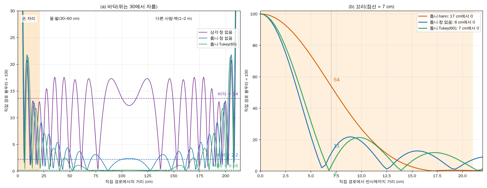
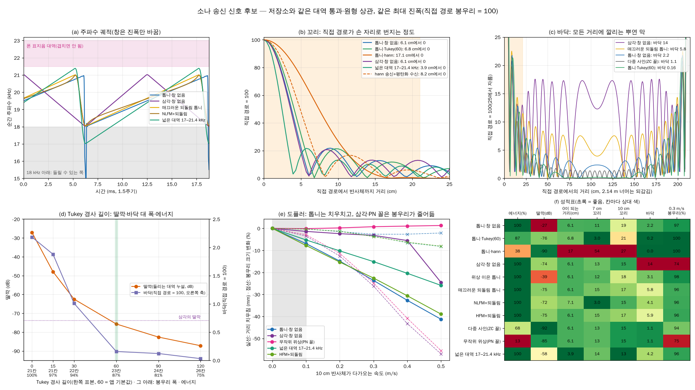
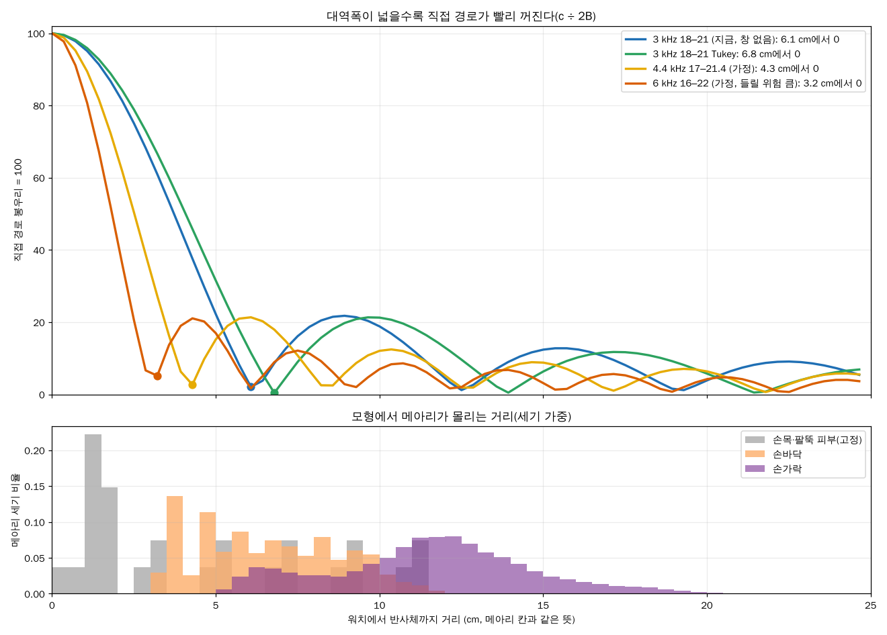
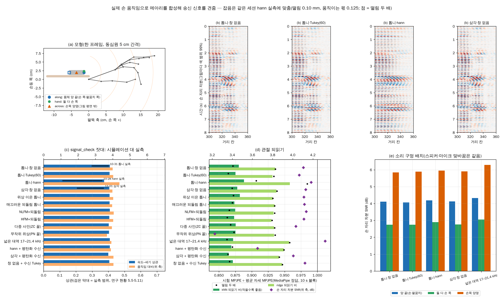

# 소나 송신 신호: 처프 모양·창·대역

2026-11-02 기준입니다. "톱니·삼각 말고 더 좋은 송신 신호가 있나, 창은 이론상으로도 손해인가, 다른 분야는 무엇을 쓰나"를 네 가지로 봤습니다.
- 이론
- 저장소와 같은 처리로 한 계산(`tools/experiments/sonar_signals.py`)
- 실제 손 움직임으로 메아리를 합성한 시뮬레이션(`tools/experiments/hand_echo_sim.py`)
- 문헌

요약은 [연구 현황 5.13](research-status.md)에 있습니다. 표기는 연구 현황과 같습니다: **[확인]** 계산·실측으로 잰 것, **[추정]** 정황으로 본 것, **[미확인]** 아직 확인하지 못한 것.

## 0. 한눈에

1. **같은 3 kHz 대역 안에서는 톱니보다 근본적으로 나은 파형이 없다.** [확인: 계산]
   - 주기 신호를 원형 상관하면 거리 응답은 송신 파워 스펙트럼의 역DFT다.
   - 그래서 처프·Zadoff–Chu·OFDM·PN 모두 스펙트럼이 같으면 봉우리도 같다. 반높이 폭은 20–21칸이고, 직접 경로가 0이 되는 거리는 6.1 cm다.
2. **hann 창은 이론상으로도 크게 불리하다.** [확인]
   - 직접 경로가 17 cm까지 번지고, 7 cm에서도 직접 경로 = 100 기준으로 54가 남는다(창 없음 11).
   - 같은 최대 진폭에서 에너지가 38%다.
   - 송신 창은 정합 필터에서 제곱으로 작용한다.
3. **수집은 톱니 + Tukey(60)를 권한다.** 앱 기본값이다. [확인: 계산]
   - 딸깍: −76 dB(창 없음 −27 dB, 삼각 −74 dB).
   - 한 주기 바닥: 0.16(창 없음 2.2, 삼각 14).
   - 대가: 에너지 87%, 봉우리 폭 +2칸, 손가락 자리 꼬리 평균 +16%.
4. **삼각은 딸깍을 없애지만 바닥이 가장 높다.** [확인]
   - 오름·내림이 엇갈려 바닥이 14다. 실측은 −19 dB(약 11)다.
   - 0.3 m/s로 움직이는 반사체에서 봉우리가 74%로 줄어든다.
   - 10-31 같은 착용 비교에서 학습도 톱니보다 나빴다(연구 현황 5.9).
5. **실측에 맞춘 손 움직임 시뮬레이션에서는 hann만 뚜렷이 나빴다.** [확인: 시뮬레이션] [추정: 실제 학습도 같은 순서]
   - hann의 되읽기는 0.2–1.0 mm 나빴다. 나머지 신호끼리의 차이는 측정 흔들림 안(0.2 mm)이다.
   - 손 자리 잡음의 대부분이 포즈와 무관한 미세 움직임과 고정 반사라, 파형을 바꾸면 잡음도 함께 바뀐다.
   - 병목은 송신 신호가 아니다.
6. **대역을 넓히면 직접 경로가 빨리 꺼진다.** [확인: 계산] [미확인: 워치 스피커 응답]
   - 0이 되는 거리: 3 kHz 6.1 cm → 4.4 kHz 4.3 cm → 6 kHz 3.2 cm.
   - 이득은 주로 손바닥 뿌리 쪽이고(3.6 cm 꼬리 53 → 16), 손가락 자리 평균 꼬리는 10.2 → 8.5 → 5.5다.
   - 시뮬레이션 되읽기에서는 이득이 보이지 않았다.
   - 스피커 응답, 들림, 표지음 대역, 공개 데이터 호환이 걸린다.
7. **이미 찍은 녹음은 수신 쪽에서 손볼 수 있다.** 원본 WAV가 필요하다. [확인: 계산·시뮬레이션] [미확인: 실제 녹음]
   - hann 녹음: 평탄화 수신으로 꼬리가 17 → 8 cm가 된다. 시뮬레이션에서 hann의 손실을 대부분 되찾았다.
   - 삼각 녹음: 평탄화 수신으로 바닥이 14 → 5.5가 된다.
   - 대가로 신호 대 잡음이 정합 필터의 절반쯤이 된다.

## 1. 잣대: 꼬리·바닥·0이 되는 거리

에코 프로파일에서 반사체 하나는 그 거리 칸에만 봉우리를 세워야 한다. 하지만 대역이 유한해서 모든 칸에 흔적이 남는다. 아래 숫자는 직접 경로(스피커 → 마이크) 봉우리를 100으로 둔 진폭 비율이다. dB로 바꾸려면 20·log10(값 ÷ 100)이다.

| 잣대 | 뜻 | 비유 |
|---|---|---|
| 꼬리 | 봉우리 옆, 손 자리 쪽으로 번지는 몫(3.6·7·10·15 cm에서 읽음) | 밝은 전등 옆의 눈부심 |
| 0이 되는 거리 | 꼬리가 처음 0(골)이 되는 거리 | 눈부심이 끝나는 곳 |
| 바닥 | 봉우리에서 먼 칸(100–290칸)에 고르게 깔리는 몫의 중앙값 | 사진 전체의 뿌연 막 |

- **0이 되는 거리에는 하한이 있다.** 3 kHz에서 c ÷ 2B = 5.7 cm이고, 대역 통과 뒤에는 6.1 cm다. 어떤 파형으로도 이보다 짧아지지 않고, 창은 오히려 늘린다. 더 줄이려면 대역을 넓히는 수밖에 없다.
- **왜 문제인가.**
  1. **메아리를 덮는다.** 손 메아리는 같은 잣대로 약 20–40이다(창 없음 시험 녹음의 손 자리 포락선 −8 ~ −15 dB, 칸 330에서 41). 3.6 cm 꼬리 53은 그 자리 메아리보다 크다.
  2. **가짜 움직임을 만든다.** 직접 경로는 줄마다 약 0.2%씩 흔들린다(실측 0.12–0.27%). 그러면 꼬리와 바닥도 같이 출렁인다.
     - 꼬리 53은 0.11, 바닥 14는 0.028만큼 출렁인다.
     - 실측 차분 바닥은 손 자리 약 0.05, 21 cm 너머 약 0.03이다.
     - 그래서 삼각의 바닥 출렁임은 실측 잡음과 같은 크기이고, 톱니는 1/7, Tukey는 1/100이다.
  3. **손 밖의 움직임이 바닥을 타고 손 자리로 샌다.** 몸이나 다른 사람의 메아리 변화에 바닥이 곱해진다.
     - 가정 계산: 직접 경로의 1/100인 메아리가 통째로 바뀐다고 하자.
     - 삼각에서는 0.14(손 자리 잡음의 약 3배), 톱니에서는 0.02, Tukey에서는 0.0016이 손 자리로 샌다.
- **바닥은 충분히 낮으면 되고, 그다음은 꼬리다.** hann은 바닥이 0.01로 가장 낮지만, 꼬리가 17 cm라 전체로는 가장 나쁘다.



(a) 바닥: 반사 하나가 한 주기(2.14 m) 전체에 남기는 막이다. 삼각은 14, 톱니·창 없음은 2.2, Tukey는 0.16이다. (b) 꼬리: 7 cm 지점에서 hann은 54, 창 없음은 11, Tukey는 3이고, 직접 경로가 0이 되는 거리는 17·6·7 cm다.

## 2. 이론: 파형보다 스펙트럼 [확인]

- **원리.** 워치는 처프 한 주기를 쉬지 않고 되풀이하고, PC는 600표본 줄마다 송신 처프와 원형 상관한다(`profiles.py`).
  - 받은 줄은 송신과 채널의 주기 합성곱이다.
  - 따라서 상관은 |X(f)|²·H(f)·|대역 통과|²의 역DFT다.
  - 파형의 위상(처프인지 부호인지)은 지워지고 파워 스펙트럼만 남는다.
- **파형으로 바꿀 수 있는 것은 다섯 가지다.**
  1. 이음새에서 새는 들리는 소리
  2. 같은 최대 진폭에서의 에너지(마루율)
  3. 도플러 특성
  4. 스펙트럼 모양(= 봉우리 모양, 창이 바꾸는 것)
  5. 한 주기 바닥
- **송신 창은 제곱으로 작용한다.** LFM은 시간과 주파수가 1:1이라 송신 창이 곧 스펙트럼 창이고, 정합 필터가 그것을 제곱한다.
  - 같은 hann이라도 송신에 걸면 폭이 41.5칸이다.
  - 수신 쪽에만 걸면 31.9칸이고, 손실은 신호 대 잡음 70%다(송신은 38%).

## 3. 손·피부·스피커·마이크

| 요소 | 값 | 신호 선택에 주는 뜻 |
|---|---|---|
| 파장 | 19.5 kHz에서 17.6 mm. 손가락 굵기 약 16 mm와 비슷 | 경로 1 mm가 위상 0.36 rad라, mm 아래 움직임에도 메아리가 바뀐다 |
| 거리 분해능 | 3 kHz에서 5.7 cm | 손가락은 거리로 갈리지 않고 간섭 무늬로 섞인다(5.10) |
| 피부 | 공기(약 400 rayl)와 조직(약 150만 rayl)의 임피던스 차로 99.9% 넘게 반사 | 피부 성질과 무관. 어떤 파형도 유리하지 않다 |
| 공기 흡수 | 20 kHz에서 m당 1 dB 미만 | 손 거리에서는 무시 |
| 스피커·마이크 | 상반성 때문에 둘을 맞바꿔도 메아리 경로가 같다 | 다른 것은 소리 구멍이 어느 쪽을 보는가뿐이다(8절) |
| 직접 경로 흔들림(실측) | 세기 줄 사이 0.12–0.27%, 위상 0.001–0.002 rad(시간 0.0004–0.0009칸) | 시계는 안정적이고 세기 흔들림이 남는다. 근거리 꼬리가 짧은 신호가 유리하다 |
| 손가락 속도 | 워치 쪽 성분이 작다(삼각 오름·내림 어긋남 σ 약 1칸, 5.9) | 도플러에 강한 파형(HFM·삼각)은 이점이 없다 |
| 메아리 거리(모형, 세기 가중 10–90%) | 손가락 7.0–15.3 cm(중앙 11.7), 손바닥 3.7–9.6 cm(중앙 6.4), 손목·팔뚝 피부 0.5–11 cm | 3 kHz에서 직접 경로가 덮는 6 cm 안은 주로 손목과 손바닥 뿌리다. 실제 창 없음 녹음에서도 손 자리 세기의 봉우리는 약 11 cm(칸 330)다 |

- **시간 흔들림을 재는 법.** 직접 경로 봉우리 위치(포물선 보간)로 시간 흔들림을 재면 0.03–0.04칸이 나오지만, 이는 추정 잡음이다. 위상으로 재야 한다(9절 함정).

## 4. 후보 신호 비교(`sonar_signals.py`) [확인: 계산]

모든 후보는 600표본 한 주기를 되풀이하고 최대 진폭을 같게 둔다. 처리는 `profiles.py`와 같다(18–21 kHz 5차 버터워스 앞뒤 → 원형 상관). 꼬리와 바닥은 직접 경로 = 100 기준이다.



| 신호 | 같은 최대 진폭 에너지 | 딸깍(0.1–15 kHz) | 0이 되는 거리 | 3.6 cm | 7 cm | 10 cm | 15 cm | 바닥 | 0.3 m/s 봉우리·치우침 |
|---|---|---|---|---|---|---|---|---|---|
| 톱니·창 없음 | 100% | −27 dB | 6.1 cm | 53 | 11 | 19 | 12 | 2.2 | 97% · −24 mm |
| 톱니·Tukey(60) | 87% | −76 dB | 6.8 cm | 59 | 3 | 21 | 6 | 0.16 | 100% · −25 mm |
| 톱니·hann | 38% | −90 dB | 17.1 cm | 85 | 54 | 27 | 3 | 0.01 | 100% · −24 mm |
| 삼각·창 없음 | 100% | −74 dB | 6.1 cm | 50 | 13 | 15 | 13 | 14 | 74% · −3 mm |
| 위상 이은 톱니(18 → 21.04 kHz) | 100% | −39 dB | 6.1 cm | 52 | 12 | 18 | 13 | 3.1 | 98% · −23 mm |
| 매끄러운 되돌림 톱니(1 ms) | 100% | −75 dB | 6.1 cm | 50 | 15 | 17 | 14 | 5.8 | 96% · −23 mm |
| NLFM + 되돌림 | 100% | −72 dB | 7.1 cm | 62 | 3 | 15 | 4 | 4.1 | 96% · −27 mm |
| HFM + 되돌림 | 100% | −75 dB | 6.1 cm | 50 | 15 | 17 | 14 | 5.9 | 96% · −23 mm |
| 다중 사인(2차 위상 = ZC 꼴) | 68% | −92 dB | 6.1 cm | 50 | 13 | 15 | 10 | 1.1 | 94% · +22 mm |
| 무작위 위상 다중 사인(PN 꼴) | 13% | −85 dB | 6.1 cm | 50 | 13 | 15 | 10 | 1.1 | 75% · +1 mm |
| 넓은 대역 17–21.4 kHz(가정) | 100% | −58 dB | 3.9 cm | 12 | 14 | 13 | 9 | 4.2 | 96% · −15 mm |

- **딸깍.** 창 없음 톱니는 이음새에서 위상(0.25바퀴)과 주파수(21 → 18 kHz)가 함께 끊긴다. 그래서 처프 에너지의 1/500이 들리는 대역으로 샌다.
  - 위상만 이으면 −39 dB이고, 주파수까지 매끄럽게 되돌리면 −75 dB이다.
  - Tukey와 삼각도 −74 ~ −76 dB로, 창 없음보다 에너지가 약 8만 분의 1이다.
- **바닥.**
  - 삼각(14)은 한 주기 안에서 같은 주파수를 두 번 지나서, 오름과 내림이 엇갈려 맞는다.
  - 되돌림 톱니(5.8)는 짧은 내림 구간이 같은 일을 작게 한다.
  - Tukey는 이음새를 진폭 0 근처에서 넘겨 0.16이다.
- **도플러.**
  - 톱니 계열은 0.3 m/s에서 봉우리가 2.4 cm 밀리지만 크기는 그대로다(거리–도플러 결합 = 도플러 주파수 ÷ 처프 기울기).
  - 삼각과 PN 꼴은 치우침이 없는 대신 봉우리가 74–75%로 줄어든다(0.5 m/s에서는 43–44%).
  - HFM은 이 속도(늘어남 0.3% 아래)에서 LFM과 같다.
  - 실제 손가락의 워치 쪽 속도는 작다.
- **마루율.** 다중 사인(ZC 꼴)은 대역 밖 에너지가 0이다(16비트 반올림 뒤 −92 dB). 그래도 같은 최대 진폭 에너지는 68%다. 무작위 위상(PN·부호 신호와 같은 꼴)은 13%다.

## 5. 창 [확인: 계산]

| Tukey 경사(한쪽 표본) | 딸깍 | 바닥 | 반높이 폭 | 에너지 |
|---|---|---|---|---|
| 0(창 없음) | −27 dB | 2.18 | 20.8칸 | 100% |
| 15 | −48 dB | 1.88 | 21.3칸 | 97% |
| 30 | −62.5 dB | 1.01 | 21.7칸 | 94% |
| **60(앱 기본값)** | **−75.7 dB** | **0.16** | **22.8칸** | **87%** |
| 90 | −82.6 dB | 0.12 | 24.2칸 | 81% |
| 120 | −87.2 dB | 0.03 | 25.9칸 | 75% |
| hann | −90 dB | 0.01 | 41.5칸 | 38% |

- **60이 무릎점이다.** 이보다 짧으면 딸깍이 남고, 길면 폭과 에너지 손해가 커진다.
- **Tukey는 손가락 자리 꼬리에서는 작은 손해다.** 모형의 메아리 거리로 가중한 꼬리 평균은 손가락 자리 10.2 대 11.8, 손바닥 자리 22.8 대 25.4다. Tukey의 이득은 딸깍과 바닥이다.
- **수신 가중은 딸깍을 못 없앤다.** 송신은 그대로 두고 수신 Tukey 25%를 걸면 0이 되는 거리 7.5 cm, 7 cm 꼬리 7, 신호 대 잡음 86%다. 하지만 딸깍은 그대로라 수집에는 송신 Tukey가 맞다. 레이더도 최대 출력이 묶이면 송신은 일정 진폭으로 두고 수신에서 가중한다(Temes 1962). 의료 초음파는 처프에 9–40% Tukey를 쓴다(9절).

## 6. 이미 찍은 녹음을 수신 쪽에서 [확인: 계산·시뮬레이션] [미확인: 실제 녹음]

| 송신 · 수신 템플릿 | 반높이 폭 | 0이 되는 거리 | 7 cm | 바닥 | 신호 대 잡음(창 없음 톱니 정합 = 100%) |
|---|---|---|---|---|---|
| 창 없음 · 정합 | 20.8칸 | 6.1 cm | 11 | 2.2 | 100% |
| 창 없음 · 수신 Tukey 25% | 25.1칸 | 7.5 cm | 7 | 2.7 | 86% |
| 창 없음 · 수신 한 창 | 31.9칸 | 11.4 cm | 33 | 2.7 | 70% |
| hann · 정합(옛 처리) | 41.5칸 | 17.1 cm | 54 | 0.01 | 38% |
| hann · 평탄화 수신(λ 0.02) | 27.3칸 | 8.2 cm | 17 | 2.8 | 19% |
| 삼각 · 정합 | 20.1칸 | 6.1 cm | 13 | 14 | 100% |
| 삼각 · 평탄화 수신(λ 0.05) | 24.3칸 | 7.1 cm | 3 | 5.5 | 50% |

- **평탄화 수신**은 송신 스펙트럼 |X|²로 나눠, 상관이 창 없음 톱니에 수신 Tukey 25%를 건 모양이 되게 하는 템플릿이다. λ는 나누는 깊이를 제한한다.
- **hann 10세션(10-27~28).**
  - 템플릿만 바꾸면 꼬리가 17 → 8 cm가 된다.
  - 시뮬레이션에서 hann의 되읽기 손실을 대부분 되찾았다(8절).
  - 신호 대 잡음은 hann 정합의 절반이 된다. 이 녹음의 손 자리 잡음은 덧붙는 잡음보다 흔들림과 미세 움직임이 커서, 그 손해가 덜 드러난다.
  - `profiles.py`에 템플릿 선택지가 필요하다(아직 없다).
- **삼각 12세션(11-01).** 바닥이 14 → 5.5가 되고, 신호 대 잡음은 절반이 된다. 오름과 내림이 겹쳐 대역 안 스펙트럼에 −42 dB 골이 생기므로, 더 평탄하게는 만들지 못한다.
- **직접 경로 빼기.** 줄마다 직접 경로 세기를 재고 알려진 봉우리 모양을 빼면, 꼬리와 그 흔들림을 함께 지울 수 있다. [미확인] 확인할 것이 두 가지다.
  - 0.5–4 cm 손목 피부 반사가 직접 경로와 겹친다.
  - 비슷한 "공통 변화 빼기"(5.10 위상 채널)는 학습을 낫게 하지 못했다.

## 7. 대역 [확인: 계산] [미확인: 워치 스피커 응답]

| 대역 | 0이 되는 거리 | 3.6 cm | 7 cm | 10 cm | 15 cm | 손가락 자리 평균 | 손바닥 자리 평균 |
|---|---|---|---|---|---|---|---|
| 3 kHz 18–21 창 없음(지금) | 6.1 cm | 53 | 11 | 19 | 12 | 10.2 | 22.8 |
| 3 kHz 18–21 Tukey | 6.8 cm | 59 | 3 | 21 | 6 | 11.8 | 25.4 |
| 4.4 kHz 17–21.4 창 없음 | 4.3 cm | 16 | 16 | 12 | 9 | 8.5 | 12.6 |
| 4.4 kHz 17–21.4 Tukey | 4.6 cm | 25 | 20 | 6 | 4 | 9.1 | 13.5 |
| 6 kHz 16–22 창 없음 | 3.2 cm | 14 | 10 | 7 | 3 | 5.5 | 10.4 |
| 6 kHz 16–22 Tukey | 3.2 cm | 6 | 3 | 2 | 5 | 5.4 | 10.2 |

- **이득은 주로 손바닥 뿌리 쪽이다.** 손가락 자리 평균은 줄지만, 곁봉우리가 봉우리 쪽으로 당겨져 특정 거리(예: 7 cm)에서는 꼬리가 커질 수 있다.
- **걸리는 것이 넷이다.**
  - 워치 스피커가 21 kHz 위와 18 kHz 아래를 얼마나 내는지 모른다. 마이크는 21.5–23 kHz 표지음을 비 100–230으로 듣는다.
  - 18 kHz 아래는 들릴 위험이 있다. 청력 문턱은 16 → 20 kHz 사이에서 수십 dB 급히 오른다(Ashihara 2007).
  - 21.5 kHz 위는 폰 표지음 대역과 겹친다.
  - 공개 데이터(18–21 kHz)로 미리 학습하기 어려워진다.
- **스피커 응답이 고르지 않으면 오히려 나빠질 수 있다.** 대역 가장자리가 약하면 실제 대역은 넓어지지 않고, 스펙트럼만 고르지 않아져 곁봉우리가 커진다. 대역을 바꾸기 전에 응답을 재야 한다.
- **되읽기 이득은 없었다.** 시뮬레이션에서 kNN은 0.2 mm 나아졌고 ridge는 0.4 mm 나빠졌다(8절).



위: 대역별 꼬리(직접 경로 = 100). 아래: 모형에서 손목·팔뚝 피부, 손바닥, 손가락 메아리가 몰리는 거리(세기 가중). 3 kHz에서 직접 경로가 덮는 6 cm 안은 주로 손목과 손바닥 뿌리다.

## 8. 실제 손 움직임 시뮬레이션(`hand_echo_sim.py`) [확인: 시뮬레이션] [추정: 실제 학습에서의 순서]

**모형**
- **관절.** 세션 20261028-215926(hann·볼륨 13)의 MediaPipe 세계 좌표를 거울 되돌림하고, 3프레임 평균한 뒤 줄 시각으로 보간해 손바닥 틀로 옮겼다. 워치를 손바닥 틀에 붙인 셈이라, 손가락 굽힘만 메아리를 바꾼다.
- **워치.** 손목에서 팔뚝 쪽 3.5 cm, 손등 쪽 2 cm에 둔다. 팔뚝 축은 평소 젖힘 25°(5.8)를 반영했다.
- **소리 구멍.** 배치 셋을 보고, 방향성은 0.2 + 0.8·(1 + cos θ)/2다(뒤쪽 −14 dB).
- **반사점.** 손가락 마디 105점, 손바닥 30점, 손목·팔뚝 피부 27점이다. 크기는 면적 × 방향성 ÷ (스피커 거리 × 마이크 거리)다.
- **잡음.** 모든 신호에 같은 표본을 쓴다.
  - 직접 경로 세기 흔들림: 줄 사이 0.2%
  - 시간 흔들림: 0.0005칸
  - 덧붙는 잡음: 먼 칸 차분 바닥 −70.8 dB에 맞춤
  - 손 떨림: 4–12 Hz

**맞추기**
- 손 메아리를 k·움직이는 손 + (1 − k)·세션 평균으로 두고, 떨림 σ × k 격자를 훑었다. 같은 세션 실제 hann 녹음의 네 값에 가장 가까운 값을 골랐다.

| | 손 자리 |차분| 중앙 | 95% | 상관 | 대비 |
|---|---|---|---|---|
| 실측 hann 녹음 | −57.1 dB | −46.9 dB | 0.362 | 3.22 |
| 시뮬레이션(떨림 0.1 mm, k 0.125) | −60.0 dB | −47.2 dB | 0.375 | 4.39 |

- k 0.125는 손 자리 메아리 중 손가락과 함께 움직이는 몫이 약 1/8이라는 뜻이다. 넷을 함께 맞추는 값은 없었고, 대비가 실측보다 높게 남는다.
- 팔뚝을 카메라 축에 고정한 첫 모형은 손 방향 변화를 모두 손목 꺾임으로 읽었다. 그 결과 손 자리 차분이 실측보다 15–23 dB 커서 버렸다.
- 바닥 계산은 실측과 맞는다. 삼각 14 대 실측 −19 dB(약 11), 창 없음 톱니 2.2 대 −34.5 dB(약 1.9)다.

**결과(소리 구멍 양 끝 배치)**

평균 자세 오차는 20.9 mm다(L 86 mm). 되읽기 비는 작을수록 좋다.

| 신호 | 상관 | 대비 | kNN 되읽기 비(mm) | ridge 되읽기 비(mm) | 차분 SNR |
|---|---|---|---|---|---|
| 톱니·창 없음 | 0.41 | 4.0 | 0.880 (18.4) | 0.936 (19.6) | 4.1 dB |
| 톱니·Tukey(60) | 0.41 | 4.0 | 0.875 (18.3) | 0.932 (19.5) | 4.1 dB |
| 톱니·hann | 0.375 | 4.4 | 0.888 (18.6) | 0.958 (20.0) | 4.2 dB |
| 삼각·창 없음 | 0.41 | 4.0 | 0.878 (18.3) | 0.938 (19.6) | 4.1 dB |
| 같은 대역 다른 파형 5종(위상 이은 톱니·되돌림·NLFM·HFM·ZC 꼴) | 0.40–0.41 | 4.0 | 0.873–0.882 | 0.930–0.935 | 4.0–4.1 dB |
| 무작위 위상(PN 꼴) | 0.405 | 3.7 | 0.875 | 0.934 | 3.2 dB |
| 넓은 대역 17–21.4 kHz | 0.41 | 3.9 | 0.872 (18.2) | 0.957 (20.0) | 4.3 dB |
| hann 송신 + 평탄화 수신 | 0.41 | 3.9 | 0.869 (18.1) | 0.949 (19.8) | 3.6 dB |
| 삼각 송신 + 평탄화 수신 | 0.40 | 4.0 | 0.865 (18.1) | 0.941 (19.7) | 4.0 dB |

- **hann만 뚜렷이 나쁘다.** 같은 대역 신호끼리는 kNN 0.873–0.882(0.2 mm 안)로 구분되지 않는다.
- **차분 SNR 4.1 dB**는 포즈 몫이 잡음보다 진폭으로 1.6배 크다는 뜻이다.
- **떨림을 두 배(0.2 mm)로 해도 순서는 같다.**
  - hann: kNN 0.907, ridge 0.984
  - 톱니·창 없음: kNN 0.871, ridge 0.936
  - hann + 평탄화 수신: kNN 0.870
- **소리 구멍 배치의 차분 SNR**은 손목 양옆 5.8–6.3 dB, 양 끝 4.1 dB, 둘 다 손 쪽 2.7–3.1 dB다. 진폭 비로는 2.0·1.6·1.4배다.
  - 둘 다 손 쪽이 가장 낮은 이유는 가까운 손목·손바닥 반사가 커져서다.
  - 크기는 방향성 가정에 기댄다.
  - 어느 배치든 hann이 가장 나쁘고 나머지는 비슷하다.
- **한계.**
  - 가려짐, 다중 반사, 손목 꺾임, 한 줄 안 도플러, 손 밖 움직임을 넣지 않았다. 그래서 삼각의 높은 바닥과 도플러 손실은 여기서 드러나지 않는다(실측 5.9에서는 드러난다).
  - 세션이 하나(3.7분)뿐이다.
  - 되읽기(kNN·ridge)는 평균 자세보다 4–13%만 나은 약한 방법이다. 실제 모델에서는 신호 사이 차이가 더 벌어질 수 있다.



(a) 모형(한 프레임). (b) 같은 8초의 손 자리 차분(톱니·창 없음, Tukey, hann, 삼각). (c) signal_check 상관·대비, 검은 막대는 실측 범위. (d) 되읽기 비와 차분 SNR, 점은 떨림 두 배. (e) 소리 구멍 배치별 차분 SNR.

## 9. 다른 분야에서 쓰는 신호

| 분야·연구 | 신호 | 잘하는 것 | 여기서는 |
|---|---|---|---|
| 레이더 펄스 압축 | LFM + 수신 쪽 가중, NLFM | 최대 출력이 묶일 때 곁봉우리 낮추기 | 수신 가중은 PC에서 바로 시험할 수 있다. NLFM은 폭이 넓어져(7.1 cm) 근거리 이득이 없다 |
| 의료 초음파 | Tukey 처프, Golay 쌍 | 해상도를 지키며 곁봉우리 낮추기 | Tukey는 같은 결론이다. Golay는 두 번 쏘는 사이에 움직이면 상쇄가 깨진다 |
| 수중 소나·박쥐 | HFM(도플러 불변) | 빠른 표적 | 0.5 m/s까지 LFM과 같다 |
| LTE·VSkin | Zadoff–Chu(VSkin: 17.3–23.25 kHz, 마루율 2.56 dB 대 M 수열 6.68 dB) | 주기 자기상관이 완벽, 마루율이 낮음 | 대역을 자르면 처프와 같은 스펙트럼이다. 폭은 같고 에너지는 68% |
| Strata | GSM 26비트 훈련열 + 채널 탭 위상 | mm 추적 | 이득은 파형이 아니라 위상 처리에서 나온다. 저장소의 위상 채널 시험은 나빠졌다(5.10) |
| LLAP | CW 16톤(17–23 kHz, 350 Hz 간격) 위상 | 한 점 3.5 mm 추적 | 거리 분해가 없어 손 전체 자세에는 맞지 않는다 |
| FingerIO | OFDM 18–20 kHz | 손가락 하나 8 mm 추적 | 스펙트럼이 같으면 봉우리도 같고, 마루율은 크다 |
| MilliSonic | FMCW 17.5–23.5 kHz + 위상 | 1-D 0.7 mm | 대역이 6 kHz다. 폰이 내고 비콘이 받는 구조다 |
| SoundWave | CW 한 톤(18–22 kHz) 도플러 | 제스처 | 거리 정보가 없다 |
| EchoWrist | FMCW 20–24 kHz(50 kHz 표본율) | 덜 들림 | 48 kHz 워치에서는 쓸 수 없다 |
| C-FMCW | 섞지 않고 교차 상관으로 거리 | 상용 기기에서 FMCW | 저장소의 처리 방식이다(WatchHand와 같음) |
| 방 음향 측정 | MLS·지수 스윕(Farina) | 비선형 왜곡 분리 | 18–21 kHz는 좁아서 지수 스윕 ≈ LFM이다 |

출처: 몇 편은 클라우드 세션의 네트워크 정책 때문에 원문을 열지 못했다. 표시한 항목은 검색 요약으로만 확인했다.
- WatchHand: Enabling Continuous Hand Pose Tracking On Off-the-Shelf Smartwatches(CHI 2026), [arXiv 2602.21610](https://arxiv.org/abs/2602.21610). 데이터 설정은 [README](https://github.com/witlab-kaist/WatchHand)로 확인했다(18–21 kHz, 600표본, 48 kHz). 창 언급은 확인하지 못했다.
- FingerIO(CHI 2016), [doi:10.1145/2858036.2858580](https://dl.acm.org/doi/10.1145/2858036.2858580) — 검색 요약
- LLAP: Device-Free Gesture Tracking Using Acoustic Signals(MobiCom 2016), [PDF](https://samsonsjarkal.github.io/KeSun/files/mobicom16_ultrasound.pdf)
- Strata(MobiSys 2017), [doi:10.1145/3081333.3081356](https://dl.acm.org/doi/10.1145/3081333.3081356) — 검색 요약
- VSkin(MobiCom 2018), [PDF](https://samsonsjarkal.github.io/KeSun/files/mobicom18_vskin.pdf)
- MilliSonic(CHI 2019), [arXiv 1901.06601](https://arxiv.org/abs/1901.06601) — 검색 요약
- SoundWave(CHI 2012), [PDF](https://www.microsoft.com/en-us/research/wp-content/uploads/2016/11/GuptaSoundWaveCHI2012.pdf)
- EchoWrist(CHI 2024), [arXiv 2401.17409](https://arxiv.org/abs/2401.17409) — 검색 요약
- C-FMCW Based Contactless Respiration Detection Using Acoustic Signal(IMWUT 2018), [doi:10.1145/3161188](https://dl.acm.org/doi/10.1145/3161188) — 검색 요약
- Temes 1962(IRE Trans. Mil. Electron. MIL-6), [IEEE](https://ieeexplore.ieee.org/document/5008423/) · Doerry, SAND2006-5856(NLFM), [OSTI](https://www.osti.gov/servlets/purl/894743)
- Misaridis & Jensen 2005(IEEE TUFFC 52:192), [doi:10.1109/tuffc.2005.1406546](https://doi.org/10.1109/tuffc.2005.1406546) · 9% Tukey 사례 [PMC2703701](https://pmc.ncbi.nlm.nih.gov/articles/PMC2703701/)
- Altes & Titlebaum 1970, "Bat signals as optimally Doppler tolerant waveforms"(JASA) — 검색 요약
- Farina 2000(AES 108th, preprint 5093), [PDF](https://angelofarina.it/Public/Papers/134-AES00.PDF)
- Ashihara 2007, "Hearing thresholds for pure tones above 16 kHz"(JASA 122:EL52), [JASA](https://pubs.aip.org/asa/jasa/article/122/3/EL52/852964/Hearing-thresholds-for-pure-tones-above-16kHz) — 검색 요약

## 10. 권하는 것(차례대로)

1. **수집은 톱니 + Tukey(60)로 한다.** 워치 화면에서 "처프 모양"은 톱니, "처프 창"은 Tukey다. 삼각을 고른 이유였던 딸깍을 Tukey가 없애면서, 삼각의 바닥 문제를 피한다. 처프 모양도 공개 데이터와 같다(창만 다르다).
2. **옛 녹음을 다시 처리한다.** hann 10세션과 삼각 12세션을 원본 WAV에서 평탄화 수신으로 다시 처리하고, `signal_check`와 학습을 견준다. `profiles.py`에 템플릿 선택지를 더해야 한다.
3. **워치 응답을 잰다.** 스피커 → 마이크 응답을 16–23.5 kHz 스윕으로 재서, 대역을 넓힐 수 있는지 본다.
4. **직접 경로 빼기를 시험한다**(6절).
5. **하지 않아도 되는 것.** PN·OFDM·HFM·NLFM·삼각처럼 파형을 바꾸는 것은 이 조건에서 이점이 없다. 신호 쪽 병목은 대역과 손 자리의 포즈 무관 몫이고, 그다음은 처리·학습이다(연구 현황 5.9–5.12).

## 11. 다시 해 보기

```bash
# 후보 신호 비교(약 15초) — 표와 그림 sonar-waveforms.png, sonar-floor-tail.png
python -I tools/experiments/sonar_signals.py --out ../hand-sonar-signal
# 손 메아리 시뮬레이션(CPU 4코어 약 15분) — 실측 잡음, 맞추기, 견주기, 대역 표, 그림 sonar-handsim.png, sonar-null-vs-hand.png
python -I tools/experiments/hand_echo_sim.py --out ../hand-sonar-signal
python -I tools/experiments/hand_echo_sim.py --out ../hand-sonar-signal --sigma 0.1 --k 0.125   # 맞추기를 건너뜀
```

- 저장소의 데이터 묶음(`data/`)만으로 돈다. numpy·scipy·matplotlib을 쓰고, 결과는 결정적이다(난수 씨앗 고정).
- 이 문서의 그림(`docs/sonar-signal/`)은 위 두 명령이 그린 것을 옮긴 것이다(`hand_echo_sim.py`는 `--sigma 0.1 --k 0.125`). `.gitignore`가 `*.png`를 막으므로 이 폴더만 예외로 열었다. 다른 그림은 저장소 밖에 쓴다.
